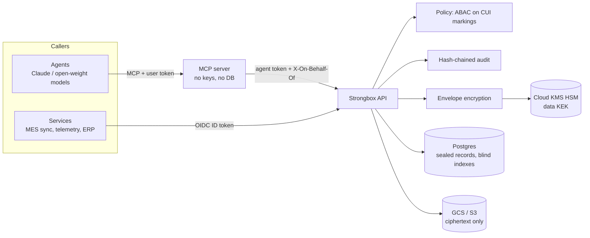

# Strongbox

Blob and structured-data storage for Controlled Unclassified Information (CUI), with one enforcement
core behind two front doors:

- **REST API** for service-to-service use (OIDC service identities, streaming uploads, idempotent writes, ETags).
- **MCP server** for agents (delegated identity, CUI content withholding, no destructive tools).

Every byte of CUI is envelope-encrypted with AES-256-GCM under data keys wrapped by a Cloud KMS HSM key.
Every access decision is made by one attribute-based policy (U.S. person, CUI categories, dissemination
controls) and written to a hash-chained audit log.



## What's in the box

| Area | Implementation |
|---|---|
| Blob storage | Streaming STREAM-construction AES-256-GCM (64 KiB segments), fresh data key per object, sealed filenames and metadata, crypto-shredding |
| Structured storage | JSON-Schema-validated collections; whole-document encryption; HMAC blind indexes for equality queries; optimistic concurrency |
| Keys | Cloud KMS (HSM) with AAD and CRC32C integrity checks; local keyring for dev only; data-key rotation and caching |
| Markings | Parser/canonicalizer for CUI banners (`CUI//SP-EXPT/PROPIN//NOFORN`); markings are bound into ciphertext AAD so a database edit can't downgrade them |
| Access control | Deny-by-default ABAC: scopes, CUI access, categories, LDCs, NOFORN and export control require U.S. persons, agent content withholding, delegation as intersection |
| Audit | Every decision (including denials and auth failures) in a SHA-256 hash chain, verified by `strongbox audit-verify`; mirrored to Cloud Logging |
| API | FastAPI, `application/problem+json` errors, request IDs, `X-Strongbox-Marking` on every CUI response, idempotency keys, ETag/If-Match |
| MCP | 11 tools over the API, read/write annotations, delegation per request, CUI withheld unless the agent is in an authorized LLM boundary |
| Backends | Postgres (Cloud SQL, AlloyDB, self-hosted Supabase) or SQLite for dev; GCS, any S3-compatible store, or local disk for dev |
| Infra | Terraform for GCP: HSM keys, CMEK bucket, private Cloud SQL with IAM auth, Cloud Run API + MCP, migration job, audit sinks |
| Quality | 122 tests, run on both SQLite and Postgres 16 (one multi-writer audit test is Postgres-only); `ruff`, `mypy --strict`, `bandit`, `pip-audit` in CI |

## Quick start (local, not for CUI)

```bash
pip install -e ".[dev,mcp]"
cp .env.example .env            # set STRONGBOX_DEV_JWT_SECRET to 32+ random characters
strongbox init                  # schema + dev keyring

strongbox principal put you@example.com --scope '*' --us-person --cui-access --category '*' --ldc '*'
strongbox principal put svc-mes --kind service --scope blobs:read --scope blobs:write \
  --scope records:read --scope records:write --scope collections:admin --us-person --cui-access --category SP-EXPT
strongbox principal put agent:claude --kind agent --scope records:read --scope records:write \
  --scope blobs:read --scope blobs:write --scope delegate --us-person --cui-access --category '*' --ldc '*'

strongbox serve --host 127.0.0.1 --port 8080
```

Or with Docker: `docker compose up --build` (Postgres + API + MCP).

### Use the API

```bash
TOKEN=$(strongbox token svc-mes)

# Store a file (raw body, marking in a header)
curl -s localhost:8080/v1/blobs -H "Authorization: Bearer $TOKEN" \
  -H "X-Strongbox-Marking: CUI//SP-EXPT//NOFORN" -H "Content-Type: text/csv" \
  -H "X-Strongbox-Filename: weld-map.csv" --data-binary @weld-map.csv

# Create a collection and a record
curl -s localhost:8080/v1/collections -H "Authorization: Bearer $TOKEN" -H 'Content-Type: application/json' -d '{
  "name": "ncr", "marking": "CUI//SP-EXPT", "indexed_fields": ["part_number", "status"],
  "json_schema": {"type": "object", "required": ["part_number"],
                  "properties": {"part_number": {"type": "string"}, "status": {"type": "string"}}}}'

curl -s localhost:8080/v1/collections/ncr/records -H "Authorization: Bearer $TOKEN" \
  -H 'Content-Type: application/json' -d '{"data": {"part_number": "TR-1042", "status": "open"}}'

curl -s localhost:8080/v1/collections/ncr/query -H "Authorization: Bearer $TOKEN" \
  -H 'Content-Type: application/json' -d '{"filters": {"part_number": "TR-1042"}}'
```

From Python services:

```python
from strongbox.client import StrongboxClient, GoogleIdTokenSource

async with StrongboxClient(API_URL, GoogleIdTokenSource("strongbox-api"), serverless_auth=True) as sb:
    blob = await sb.put_blob(open("weld-map.csv", "rb").read(), marking="CUI//SP-EXPT", filename="weld-map.csv")
    rec = await sb.create_record("ncr", {"part_number": "TR-1042", "status": "open"})
    rec = await sb.update_record("ncr", rec["id"], {"part_number": "TR-1042", "status": "closed"}, expected_version=1)
```

The full OpenAPI document is in [docs/openapi.json](docs/openapi.json) (or `/docs` when `expose_docs` is on).

### Connect an agent over MCP

Claude Desktop / Claude Code (stdio):

```json
{
  "mcpServers": {
    "strongbox": {
      "command": "strongbox",
      "args": ["mcp"],
      "env": {
        "STRONGBOX_MCP_API_URL": "http://127.0.0.1:8080",
        "STRONGBOX_MCP_TOKEN": "<strongbox token agent:claude>",
        "STRONGBOX_MCP_ON_BEHALF_OF": "<strongbox token you@example.com>"
      }
    }
  }
}
```

Shared deployments use streamable HTTP (`strongbox mcp --transport streamable-http`), where each user
authenticates with their own token. See [docs/MCP.md](docs/MCP.md).

## Running on Supabase

Supabase is a reasonable substrate if you self-host it inside your boundary: point
`STRONGBOX_DATABASE_URL` at its Postgres and use the `s3` blob backend against its Storage S3 endpoint.
Keep three rules:

1. **Strongbox does the encryption**, not Supabase Vault/pgsodium (libsodium ciphers are not FIPS-approved,
   and pgsodium is slated for deprecation).
2. **Nothing but the Strongbox API talks to those tables and buckets.** Exposing PostgREST, the Storage
   API or Realtime to clients would bypass policy and audit. Revoke `anon`/`authenticated` grants.
3. Supabase Storage does not support S3 versioning, so deletes are permanent; rely on Postgres backups
   plus your own retention for blob recovery.

Hosted Supabase is a commercial SaaS outside an ITAR/Assured Workloads boundary, so it is fine for
UNCONTROLLED data only. See [docs/ARCHITECTURE.md](docs/ARCHITECTURE.md#supabase).

## Production

See [docs/SECURITY.md](docs/SECURITY.md) before deploying. In short:

1. Create the project inside an Assured Workloads folder for your regime (ITAR or IL4/IL5) with a VPC
   Service Controls perimeter around KMS, Storage, Cloud SQL and Cloud Run.
2. Build the FIPS image: `make docker-fips BASE_IMAGE=<FIPS-validated Python base>`.
3. `terraform apply` in [infra/terraform](infra/terraform), run the `strongbox-migrate` job, then register
   principals with `strongbox principal put` (the first admin must be created from the job/CLI).

`STRONGBOX_ENV=production` refuses to start with a local keyring, dev tokens, SQLite, local blob storage,
exposed docs, or a non-FIPS crypto module.

## Layout

```
src/strongbox/
  crypto/        envelope.py (AES-256-GCM stream + seal), kms.py (Cloud KMS, local), fips.py
  auth/          principal.py (registry, delegation), tokens.py (OIDC, dev), policy.py (ABAC)
  storage/       schema.py, database.py, blobstore.py (local, GCS, S3)
  services/      blobs.py, records.py, keys.py (data keys, blind index), guard.py, container.py
  api/           FastAPI app, routes, middleware, schemas
  markings.py    CUI banner parsing and roll-up
  audit.py       hash-chained audit log
  client.py      async Python SDK
  mcp_server.py  MCP server
  cli.py         strongbox command
infra/terraform  GCP deployment
tests/           122 tests (SQLite by default; set STRONGBOX_TEST_DATABASE_URL to run on Postgres)
```
