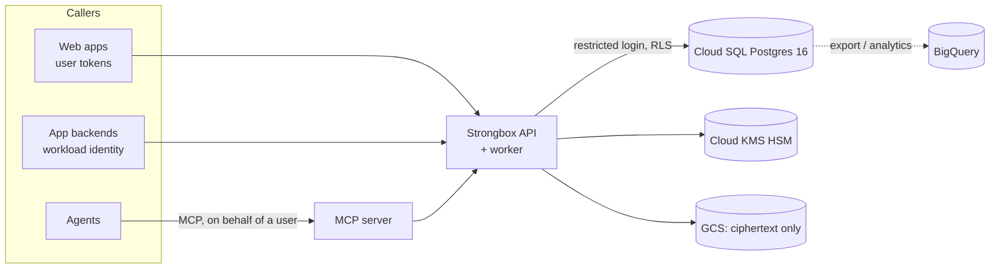

# Strongbox (storage_relspace)

Shared persistence for Dreamcatcher apps: personal state, team records, app-wide data and encrypted
attachments, with access boundaries enforced by the service and again by PostgreSQL row-level
security. Written in Go; CUI-grade encryption (AES-256-GCM under Cloud KMS HSM keys, Go's FIPS 140-3
module); every decision audited in per-app hash chains.

Apps reach it over HTTP (`/v1/apps/{app}/…`), agents over MCP, and code through the Go and TypeScript
clients. Apps never get database credentials or SQL access.



## What it gives an app

| | |
|---|---|
| **Isolation** | Every row belongs to one app (`<app_id>:<env>`). A request names an app; membership grants access. Cross-app references are impossible by foreign key, and RLS refuses rows outside the app even if service code forgot a filter. |
| **Sharing** | Private by default. Records and blobs can be shared with a team, the whole app, or individuals (viewer/editor, optional re-share). Sharing is separate from editing; markings and clearances still apply. |
| **Predictable saves** | Compare-and-swap updates (`If-Match`), operation IDs that make retries safe (a lost response returns the original result), history with undo, audit in the same transaction. |
| **Contracts** | Versioned JSON Schema per collection with indexed and unique fields. Compatible changes apply at once; others run a resumable migration job that validates every record before the switch. |
| **Attachments** | Encrypted blobs: one request up to 16 MiB, resumable upload sessions up to 5 GiB. |
| **Budgets** | Per-app quotas enforced in the database, per-app and per-user rate limits, a per-app share of the connection pool, bounded pages and responses. |
| **Recovery** | `export` (all table payloads sealed, one snapshot, authenticated manifest), offline/authenticated validation, `restore -dry-run`, measured `restore-drill`. |
| **Operations** | OpenTelemetry metrics (no high-cardinality labels), outbox worker, scoped `reconcile`, `inventory`, `usage`, `audit-verify`. |

## Try it locally (not for CUI)

With Docker:

```bash
docker compose up --build
docker compose exec api /strongbox principal put you@example.com -scope '*' -us-person -cui-access -category '*'
docker compose exec api /strongbox admin app create notes:dev -name Notes -admin you@example.com
TOKEN=$(docker compose exec -T api /strongbox token you@example.com)
curl -s -H "Authorization: Bearer $TOKEN" -H 'Content-Type: application/json' localhost:8080/v1/apps/notes/collections \
  -d '{"name":"todo","marking":"UNCONTROLLED"}'
curl -s -H "Authorization: Bearer $TOKEN" -H 'Content-Type: application/json' -H 'Idempotency-Key: first-todo-1' \
  localhost:8080/v1/apps/notes/collections/todo/records -d '{"data":{"title":"hello"}}'
```

Without Docker, against any PostgreSQL 16 superuser URL, the TypeScript demo starts a throwaway server
and walks private state, team sharing, conflict recovery and undo:

```bash
cd clients/typescript && npm ci
PG_ADMIN_URL=postgres://postgres:pw@localhost:5432/postgres scripts/live-server.sh > .live.env
. ./.live.env && npm run example && npm test
kill $STRONGBOX_PID
```

The API is described by [internal/api/openapi.json](internal/api/openapi.json) (`strongbox openapi`).

## Clients

- Go: [`pkg/client`](pkg/client) — `client.New(url, token).App("notes")`.
- TypeScript: [`clients/typescript`](clients/typescript) — types generated from the OpenAPI contract.
- MCP: `strongbox mcp` (stdio or streamable HTTP), 13 tools, no destructive ones; content an agent is
  not cleared for is withheld.

## Production

Read [docs/SECURITY.md](docs/SECURITY.md) and [docs/OPERATIONS.md](docs/OPERATIONS.md) first. In short:
an Assured Workloads project with VPC Service Controls; `terraform apply` in
[infra/terraform](infra/terraform) (separate runtime and migration identities); one-time `CREATEROLE`
for the migration login; run the migrate job; create apps, members and quotas with `strongbox admin`.
`STRONGBOX_ENV=production` refuses local keys, dev tokens, local blobs, exposed docs, or a non-FIPS
build, and `serve` refuses a database login that could bypass row-level security.

## Documentation

| | |
|---|---|
| [ARCHITECTURE.md](docs/ARCHITECTURE.md) | App model, trust boundary, roles and RLS, disclosure and revocation rules, encryption contexts, receipts, audit, outbox |
| [SECURITY.md](docs/SECURITY.md) | NIST SP 800-171 mapping, threat model, deployment checklist |
| [RECOVERY_AND_RECONCILIATION.md](docs/RECOVERY_AND_RECONCILIATION.md) | Sealed backups, recovery drills and scoped cleanup |
| [OPERATIONS.md](docs/OPERATIONS.md) | Deployment, migrations, budgets, keys and KMS failure, worker, metrics, export and restore |
| [RETENTION.md](docs/RETENTION.md) | What delete, purge, shred, history expiry and backup expiry each remove |
| [STORED_FORMATS.md](docs/STORED_FORMATS.md) | Every persistent format ever written and how it is read |
| [REFERENCES.md](docs/REFERENCES.md) | Upstream projects examined, versions, licenses, what was adopted |
| [evidence/](docs/evidence) | Review-finding reproductions and synthetic load results |

## Layout

```
cmd/strongbox/          CLI: init, db, serve, worker, mcp, admin, principal, token, usage, inventory,
                        export, validate-export, restore, audit-verify, fips-check, keyring, openapi
cmd/strongbox-load/     synthetic load harness
internal/store/         pgx pool, transaction runner (scope, RLS context), roles, migrations, blob backends
internal/service/       records, contracts, history, blobs, uploads, sharing, receipts, keys, worker, verify
internal/api/           HTTP API, budgets, openapi.json
internal/auth/          principals, OIDC/dev tokens, ABAC policy
internal/audit/         per-app hash-chained audit
internal/admin/         privileged operations (apps, members, quotas, legacy assignment)
internal/backup/        export, validation, restore
internal/crypto/        envelope encryption, KMS, FIPS checks
internal/telemetry/     OpenTelemetry metrics
pkg/client/             Go client
clients/typescript/     TypeScript client
infra/terraform/        GCP deployment
```

Tests need PostgreSQL 16 and fail without it: `make test` (`PG_URL`), `make race`, `make test-fips`;
`make test-unit` runs without a database.
