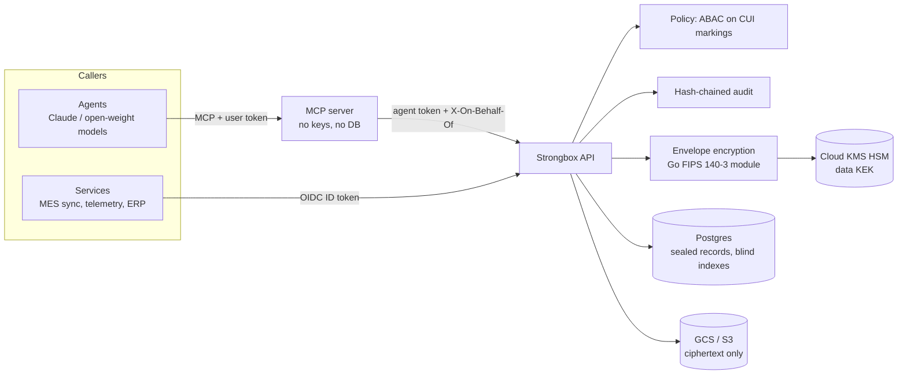

# Strongbox (storage_relspace)

Blob and structured-data storage for Controlled Unclassified Information (CUI), written in Go, with one
enforcement core behind two front doors:

- **REST API** for service-to-service use (OIDC service identities, streaming uploads, idempotent writes, ETags).
- **MCP server** for agents (delegated identity, CUI content withholding, no destructive tools).

Every byte of CUI is envelope-encrypted with AES-256-GCM under data keys wrapped by a Cloud KMS HSM key,
using Go's native FIPS 140-3 module. Every access decision is made by one attribute-based policy
(U.S. person, CUI categories, dissemination controls) and written to a hash-chained audit log.



## What's in the box

| Area | Implementation |
|---|---|
| Blob storage | Segmented AES-256-GCM (64 KiB segments, module-generated nonces, index + final flag in AAD), fresh data key per object, sealed filenames and metadata, crypto-shredding |
| Structured storage | JSON-Schema-validated collections; whole-document encryption; HMAC blind indexes for equality queries; optimistic concurrency |
| FIPS | Built with `GOFIPS140=v1.0.0`; the full test suite passes under `GODEBUG=fips140=only`; production refuses to start outside FIPS mode |
| Keys | Cloud KMS (HSM) with AAD and CRC32C integrity checks; local keyring for dev only; data-key rotation and caching |
| Markings | Parser/canonicalizer for CUI banners (`CUI//SP-EXPT/PROPIN//NOFORN`), bound into ciphertext AAD so a database edit can't downgrade them |
| Access control | Deny-by-default ABAC: scopes, CUI access, categories, LDCs; NOFORN and export control require U.S. persons; agent content withholding; delegation as intersection |
| Audit | Every decision (including denials and auth failures) in a SHA-256 hash chain with row-locked appends; `strongbox audit-verify`; mirrored to Cloud Logging |
| API | `net/http`, `application/problem+json` errors, request IDs, `X-Strongbox-Marking` on every CUI response, idempotency keys, ETag/If-Match, OpenAPI contract test |
| MCP | 11 tools on the official Go MCP SDK; stdio and streamable HTTP with bearer auth and protected-resource metadata |
| Backends | Postgres (Cloud SQL, AlloyDB, self-hosted Supabase); GCS, any S3-compatible store (incl. Supabase Storage), or local disk for dev |
| Clients | Go (`pkg/client`) and Python (`clients/python`), both with automatic idempotency keys and retries |
| Infra | Terraform for GCP: HSM keys, CMEK bucket, private Cloud SQL with IAM auth, Cloud Run API + MCP, migration job, audit sinks |
| Quality | 65 Go test functions on real Postgres (race detector and enforced-FIPS runs in CI), Python client tests against the Go server, `staticcheck`, `govulncheck` |

## Quick start (local, not for CUI)

Needs Go 1.26+ and Postgres (or `docker compose up --build`).

```bash
export STRONGBOX_DATABASE_URL="postgres://postgres@localhost:5432/strongbox?sslmode=disable"
export STRONGBOX_DEV_JWT_SECRET="$(openssl rand -hex 32)"

make build-fips                     # bin/strongbox with the FIPS 140-3 module
bin/strongbox init                  # migrations + dev keyring

bin/strongbox principal put you@example.com -scope '*' -us-person -cui-access -category '*' -ldc '*'
bin/strongbox principal put svc-mes -kind service -scope blobs:read -scope blobs:write \
  -scope records:read -scope records:write -scope collections:admin -us-person -cui-access -category SP-EXPT
bin/strongbox principal put agent:claude -kind agent -scope records:read -scope records:write \
  -scope blobs:read -scope blobs:write -scope delegate -us-person -cui-access -category '*' -ldc '*'

bin/strongbox serve -addr 127.0.0.1:8080
```

### Use the API

```bash
TOKEN=$(bin/strongbox token svc-mes)

# Store a file (raw body, marking in a header)
curl -s localhost:8080/v1/blobs -H "Authorization: Bearer $TOKEN" \
  -H "X-Strongbox-Marking: CUI//SP-EXPT//NOFORN" -H "Content-Type: text/csv" \
  -H "X-Strongbox-Filename: weld-map.csv" --data-binary @weld-map.csv

# Create a collection and a record
curl -s localhost:8080/v1/collections -H "Authorization: Bearer $TOKEN" -d '{
  "name": "ncr", "marking": "CUI//SP-EXPT", "indexed_fields": ["part_number", "status"],
  "json_schema": {"type": "object", "required": ["part_number"],
                  "properties": {"part_number": {"type": "string"}, "status": {"type": "string"}}}}'

curl -s localhost:8080/v1/collections/ncr/records -H "Authorization: Bearer $TOKEN" \
  -d '{"data": {"part_number": "TR-1042", "status": "open"}}'

curl -s localhost:8080/v1/collections/ncr/query -H "Authorization: Bearer $TOKEN" \
  -d '{"filters": {"part_number": "TR-1042"}}'
```

From Go services:

```go
ts, _ := client.GoogleIDToken(ctx, "strongbox-api")
sb := client.New(apiURL, ts, client.WithServerlessAuth())
blob, _ := sb.PutBlob(ctx, data, client.BlobOptions{Marking: "CUI//SP-EXPT", Filename: "weld-map.csv"})
rec, _ := sb.CreateRecord(ctx, "ncr", map[string]any{"part_number": "TR-1042", "status": "open"}, "")
```

From Python (Spark/Airflow jobs, notebooks): `pip install ./clients/python`

```python
from strongbox_client import StrongboxClient, GoogleIdTokenSource

async with StrongboxClient(API_URL, GoogleIdTokenSource("strongbox-api"), serverless_auth=True) as sb:
    blob = await sb.put_blob(csv_bytes, marking="CUI//SP-EXPT", filename="weld-map.csv")
```

The API contract is [internal/api/openapi.json](internal/api/openapi.json) (served at `/openapi.json`
when `STRONGBOX_EXPOSE_DOCS=true`). A test fails if a route and the document disagree.

### Connect an agent over MCP

Claude Desktop / Claude Code (stdio):

```json
{
  "mcpServers": {
    "strongbox": {
      "command": "/path/to/bin/strongbox",
      "args": ["mcp"],
      "env": {
        "STRONGBOX_MCP_API_URL": "http://127.0.0.1:8080",
        "STRONGBOX_MCP_TOKEN": "<strongbox token agent:claude>",
        "STRONGBOX_MCP_ON_BEHALF_OF": "<strongbox token you@example.com>"
      }
    }
  }
}
```

Shared deployments use streamable HTTP (`strongbox mcp -transport streamable-http`), where each user
authenticates with their own token. See [docs/MCP.md](docs/MCP.md).

## Running on Supabase

Self-hosted Supabase works as the substrate: point `STRONGBOX_DATABASE_URL` at its Postgres and use the
`s3` blob backend with `STRONGBOX_S3_ENDPOINT_URL=https://<host>/storage/v1/s3` (path-style is forced).
Keep three rules:

1. **Strongbox does the encryption**, not Supabase Vault/pgsodium (libsodium ciphers are not FIPS-approved,
   and pgsodium is slated for deprecation).
2. **Nothing but the Strongbox API talks to those tables and buckets.** Exposing PostgREST, the Storage
   API or Realtime to clients would bypass policy and audit. Revoke `anon`/`authenticated` grants.
3. Supabase Storage does not support S3 versioning, so deletes are permanent; rely on Postgres backups
   plus your own retention for blob recovery.

Hosted Supabase is a commercial SaaS outside an ITAR/Assured Workloads boundary, so use it for
UNCONTROLLED data only. See [docs/ARCHITECTURE.md](docs/ARCHITECTURE.md#supabase).

## Production

See [docs/SECURITY.md](docs/SECURITY.md) before deploying. In short:

1. Create the project inside an Assured Workloads folder for your regime (ITAR or IL4/IL5) with a VPC
   Service Controls perimeter around KMS, Storage, Cloud SQL and Cloud Run.
2. `docker build -t <registry>/strongbox:<version> .` (links the FIPS module) and push to Artifact Registry
   inside the boundary.
3. `terraform apply` in [infra/terraform](infra/terraform), run the `strongbox-migrate` job, then register
   principals with `strongbox principal put` (the first admin must be created from the job or CLI).

`STRONGBOX_ENV=production` refuses to start with a local keyring, dev tokens, local blob storage,
exposed docs, or the FIPS module inactive.

## Layout

```
cmd/strongbox/         CLI: init, serve, mcp, principal, token, audit-verify, gc, fips-check, keyring, openapi
internal/crypto/       envelope.go (AES-256-GCM stream + seal), kms.go (Cloud KMS, local), fips.go
internal/markings/     CUI banner parsing and roll-up
internal/auth/         principals + registry, OIDC/dev tokens, ABAC policy
internal/audit/        hash-chained audit log
internal/store/        pgx pool, embedded migrations, blob backends (local, GCS, S3)
internal/service/      blobs, records, data keys + blind index, policy/audit guard
internal/api/          HTTP API + openapi.json contract
internal/mcpserver/    MCP tools, bearer auth, streamable HTTP
internal/testenv/      per-test Postgres schema harness
pkg/client/            Go client
clients/python/        Python client (+ live tests against the Go server)
infra/terraform/       GCP deployment
```

Tests: `make test` (set `PG_URL`; integration tests skip without Postgres), `make test-fips`, `make race`.
